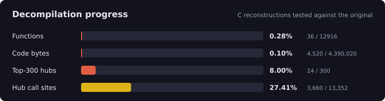

<p align="center"></p>

<p align="center">
   
  
</p>

<p align="center">
  <b>Decompilation toolkit and symbol map for FF7 DoC (PS2, SLPM-66629)</b><br>
  <a href="README.id.md">Bahasa Indonesia</a> · <a href="docs/PROGRESS.md">Progress</a> · <a href="docs/ANALYSIS.md">Analysis</a> · <a href="LEGAL.md">Legal</a>
</p>

---

## Progress

<!-- PROGRESS:START -->
<p align="center"></p>

| | Done | Total |
|---|---:|---:|
| Functions | 36 (0.28%) | 12916 |
| Code bytes | 0.10% | 4,390,020 |
| Most-called 300 | 24 (8.0%) | 300 |

Details and history: [docs/PROGRESS.md](docs/PROGRESS.md)
<!-- PROGRESS:END -->

A function counts as **decompiled** only when its C passes differential tests against the original code (`make test`). Byte-matching builds need `ee-gcc` and are not done yet.

## Project

| Item | Value |
|---|---|
| Game ID | SLPM-66629 (Japan) |
| Target | `SLPM_666.29`, MIPS R5900, ELF32 |
| Named functions | 78 (syscalls, SDK, libc, decompiled) |

## Quick start

Python 3.9+ and `gcc` (for tests). No other dependencies.

```sh
cp /path/to/SLPM_666.29 game/    # your own dump, never committed
make verify                      # SHA-256 check
make test                        # C vs original, libc + game functions
python -m ps2an info game/SLPM_666.29
python -m ps2an disasm game/SLPM_666.29 lock_acquire -n 20
```

## Tools

| Command | Purpose |
|---|---|
| `info` `functions` `strings` `xrefs` `embedded` | Inspect the ELF |
| `sdk` `ident` | Name syscall wrappers, SDK and libc functions by evidence |
| `hubs` | Most-called functions: next targets |
| `disasm` `split` `stubs` | Local disassembly and C stubs (`INCLUDE_ASM`) |
| `ghidra <gzf>` | Compare function detection with a Ghidra export |
| `progress` | Update progress files (`--check` for CI) |
| `verify` | Check ELF SHA-256 |

## How a function is verified

1. Write C in `src/game/`; add it to `tests/game_test.py`.
2. The test maps guest memory at identical host addresses and runs the C and the original (in the built-in emulator) on the same random memory.
3. Return value, **all** memory and the sequence of calls to other functions must match; the original must be 100% covered.
4. `make progress` updates the numbers above.

## Repository model: public vs private

| | Public repo (this) | Private dev package |
|---|---|---|
| Tools, docs, tests | yes | yes |
| Symbols (address, size, name) | yes | yes |
| C reconstructions | yes | yes |
| Game ELF, Ghidra project | **never** | yes |
| Disassembly, strings, asm | **never** | yes |

`make release` builds both archives in `dist/`: `*-public.zip` (push this) and `*-dev.zip` (keep private). `scripts/verify_public.py` blocks binaries, assembly listings and oversized files, and runs in CI.

## Layout

```
ps2an/      analysis toolkit and emulator
symbols/    functions.csv, named.txt, hubs.csv (metadata only)
src/        game/ libc/ include/ stubs/
tests/      differential tests
progress/   progress.json, history.csv
docs/       ANALYSIS.md, PROGRESS.md
game/       your files, git-ignored
```

## Contributing

Pick a function from `symbols/hubs.csv`, reconstruct it, make `make test` pass, run `make progress`, open a PR with C only. Never include assembly, binaries or assets.

## Legal

You supply your own copy; no game binaries or assets are distributed. See [LEGAL.md](LEGAL.md). Tooling is MIT.
